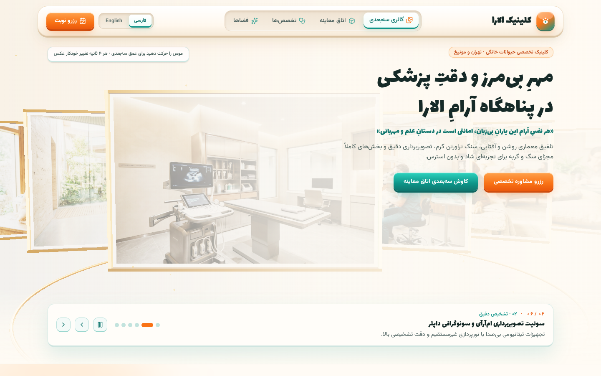
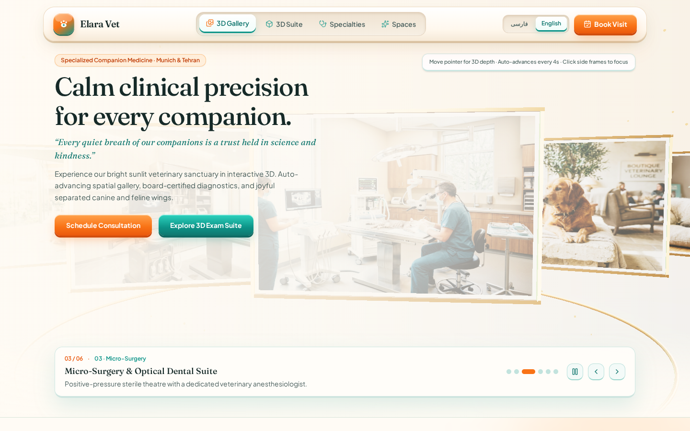
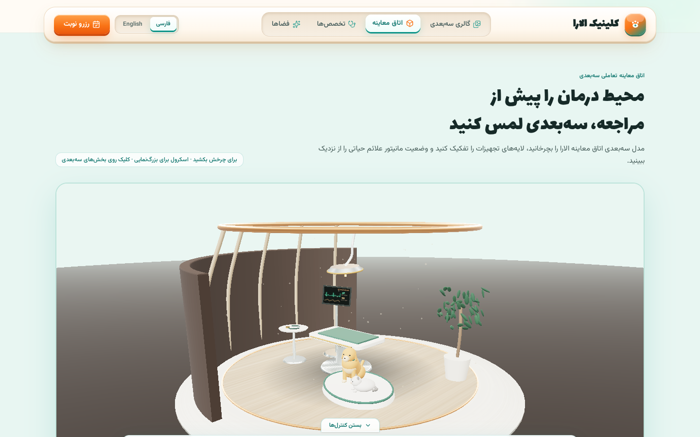
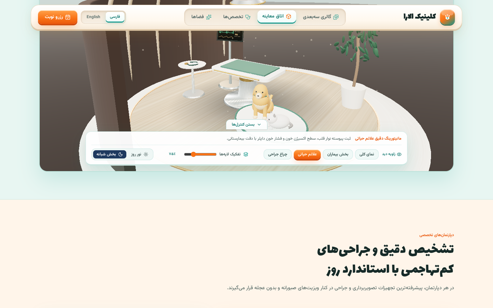
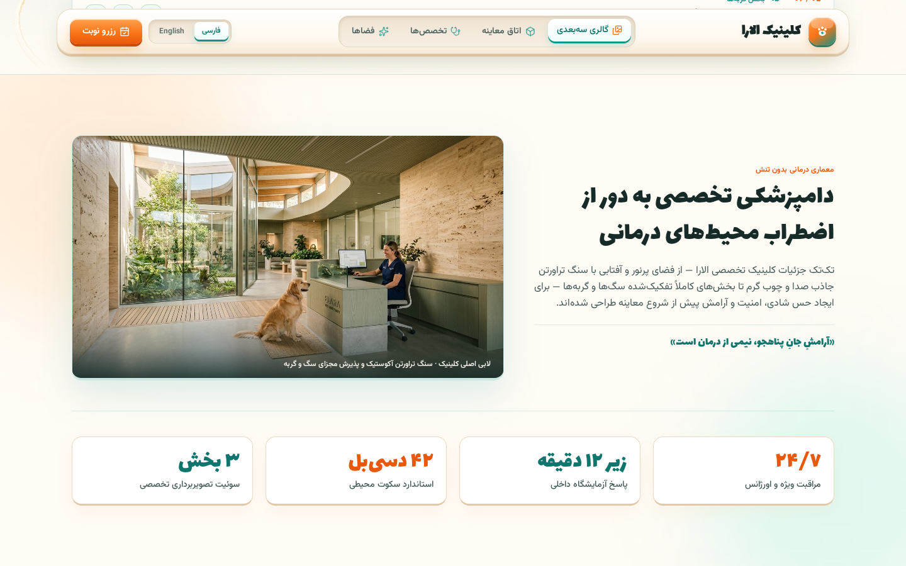
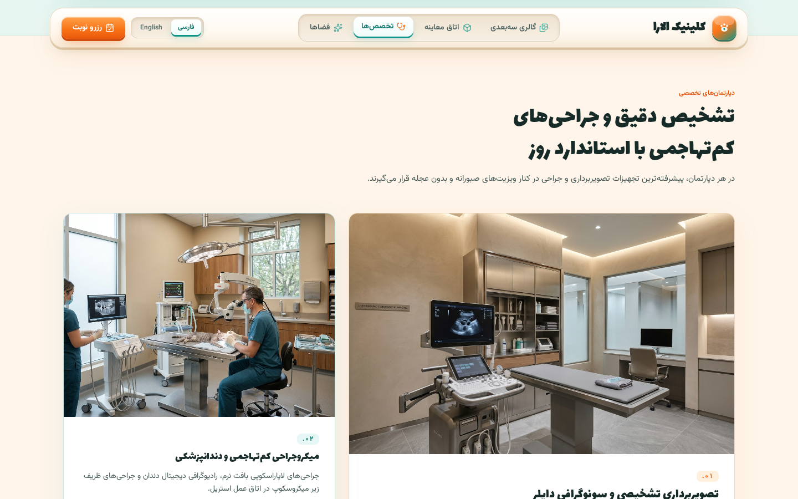
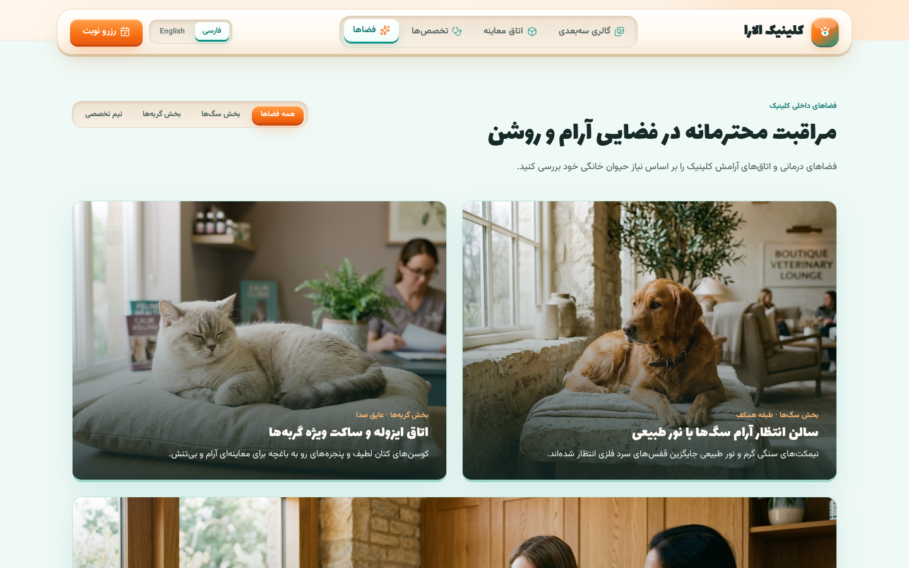
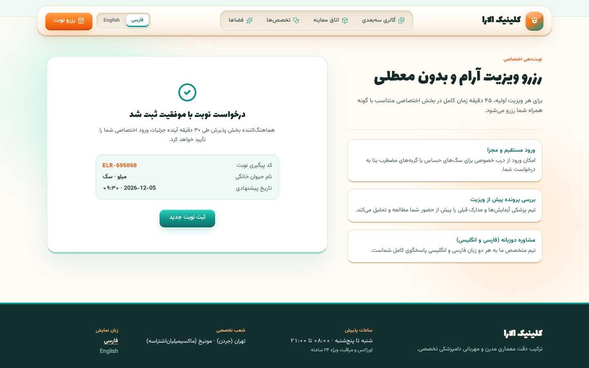
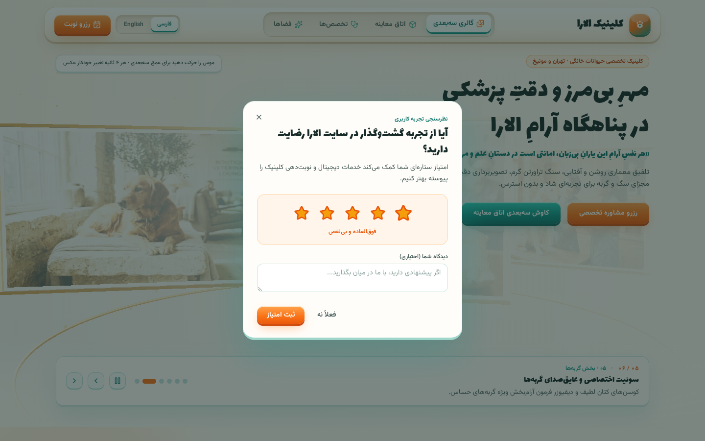
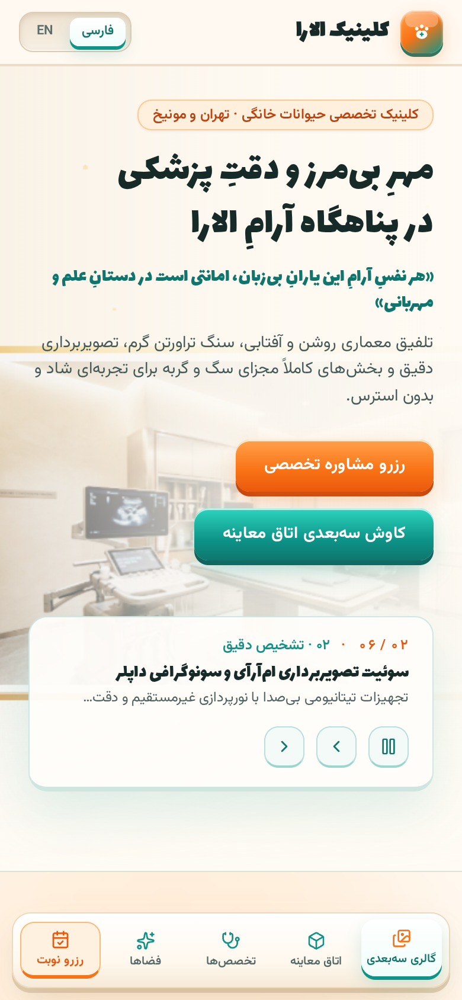

<div align="center">



# 🐾 Elara Vet Sanctuary · کلینیک تخصصی دامپزشکی الارا

**An interactive 3D specialized companion veterinary clinic web experience — sunlit architectural atmosphere, real-time Three.js scenes, tactile 3D navigation, and complete Persian (`RTL`) & English (`LTR`) localization.**

[](https://amiralisite.github.io/elara-vet-clinic/)
[](https://github.com/amiraliSite/elara-vet-clinic)

[🌐 مشاهده وب‌سایت آنلاین](https://amiralisite.github.io/elara-vet-clinic/)

</div>

---

## ✨ Highlights & Features · ویژگی‌های کلیدی

| Feature | Description |
| :--- | :--- |
| **🎞️ 3D Curved Hero Photo Slider** | Auto-advancing 3D WebGL photography gallery built with `Three.js`, pointer-driven camera parallax, clickable side frames, directional RTL/LTR framing, and sunlit travertine floor with golden orbit rail. |
| **🩺 Interactive 3D Exam Suite** | Full 360° orbitable veterinary examination suite featuring sculpted dog & cat companions, heated travertine exam table, articulated surgical lamp, **exploded architectural layer slider (0–100%)**, **Daylight / Evening Ward lighting moods**, and a **live animated ECG vital monitor** rendered dynamically in Persian or English. |
| **🧭 Tactile 3D Navbar & Mobile Dock** | Elevated 3D desktop floating bar with custom sculpted paw-heart emblem, recessed icon-pill tray, embedded **Persian / English** language toggle, extruded coral 3D booking button, and a fixed **mobile bottom thumb-navigation dock**. |
| **🌍 Full Bilingual (`FA` / `EN`)** | Instant switching between **Persian (RTL)** with `Lalezar` + `Vazirmatn` typography and **English (LTR)** with `Fraunces` + `Plus Jakarta Sans`—synchronizing every headline, booking slot, rating label, and 3D canvas screen. |
| **🃏 Perspective 3D Cards & Gallery** | Pointer-tracked 3D perspective tilt cards with warm sunlit specular sheen and filterable spaces (`All`, `Canine`, `Feline`, `Specialists`). |
| **📅 Private Consultation Booking** | Species selector, service discipline picker, localized time windows, validation, and instant reference code confirmation receipt (`ELR-XXXXXX`). |
| **⭐ 20s Satisfaction Modal** | Non-intrusive timed 5-star visitor experience popup appearing 20 seconds after session entry with interactive star labels and optional feedback note. |

---

## 📸 Visual Tour · تصاویر بخش‌های مختلف سایت

### 1. Sunlit 3D Hero Gallery — Bilingual (`فارسی` RTL & `English` LTR)

<table>
  <tr>
    <td width="50%">
      
      <p align="center"><b>نمای اصلی فارسی (RTL)</b> — فونت <code>Lalezar</code> و اسلایدر عکس سه‌بعدی</p>
    </td>
    <td width="50%">
      
      <p align="center"><b>English Mode (LTR)</b> — <code>Fraunces</code> Display & 3D Gallery Parallax</p>
    </td>
  </tr>
</table>

---

### 2. Interactive 3D Examination Sanctuary (`Daylight` vs `Exploded + Evening Ward`)

<table>
  <tr>
    <td width="50%">
      
      <p align="center"><b>اتاق معاینه سه‌بعدی (نور روز)</b> — چرخش ۳۶۰ درجه، بیمارها و مانیتور ECG</p>
    </td>
    <td width="50%">
      
      <p align="center"><b>تفکیک لایه‌ها (۷۵٪) و بخش شبانه</b> — نمای علائم حیاتی و نورپردازی گرم</p>
    </td>
  </tr>
</table>

---

### 3. Philosophy, Specialties & Filterable Clinic Spaces

<table>
  <tr>
    <td width="33.3%">
      
      <p align="center"><b>معماری آرامش‌بخش و شاخص‌ها</b></p>
    </td>
    <td width="33.3%">
      
      <p align="center"><b>دپارتمان‌های تخصصی سه‌بعدی</b></p>
    </td>
    <td width="33.3%">
      
      <p align="center"><b>گالری فضاها با فیلتر مجزا</b></p>
    </td>
  </tr>
</table>

---

### 4. Consultation Confirmation, 20s 5-Star Feedback Modal & Mobile Bottom Dock

<table>
  <tr>
    <td width="40%">
      
      <p align="center"><b>تأیید رزرو نوبت با کد پیگیری</b></p>
    </td>
    <td width="40%">
      
      <p align="center"><b>پاپ‌آپ نظرسنجی ۵ ستاره (پس از ۲۰ ثانیه)</b></p>
    </td>
    <td width="20%">
      
      <p align="center"><b>نوبار پایین در موبایل</b></p>
    </td>
  </tr>
</table>

---

## 🛠️ Tech Stack · فناوری‌های استفاده‌شده

- **Frontend Core**: React 19 + TypeScript + Vite 8
- **3D Engine**: Three.js (`RoomEnvironment`, `OrbitControls`, `MeshPhysicalMaterial`, `CanvasTexture` real-time ECG rendering, `InstancedMesh` sunlit motes)
- **Styling & Motion**: Tailwind CSS v4 + Motion (`motion/react`) + Custom CSS 3D tactile bevel system
- **Typography**: `Lalezar` & `Vazirmatn` (Persian) · `Fraunces` & `Plus Jakarta Sans` (English)
- **Icons**: Lucide React + Custom 3D Paw-Heart Emblem SVG

---

## 🚀 Local Development · اجرای محلی

```bash
# 1. Install dependencies
npm install

# 2. Start development server (http://localhost:3000)
npm run dev

# 3. Typecheck & build production bundle
npm run lint
npm run build
```

---

<div align="center">
  Crafted with warm architecture, playful 3D depth, and gentle care for every companion. 🐾
</div>
